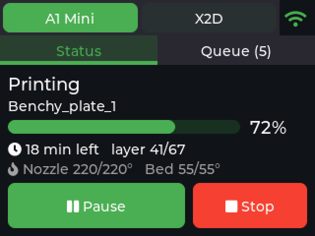
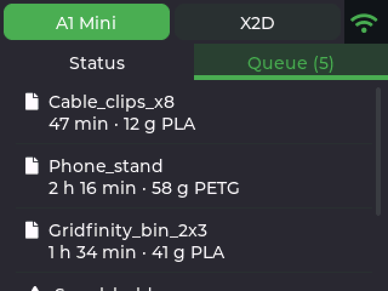
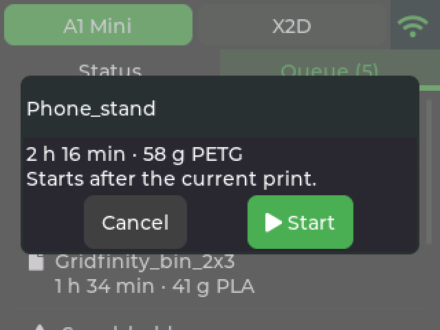
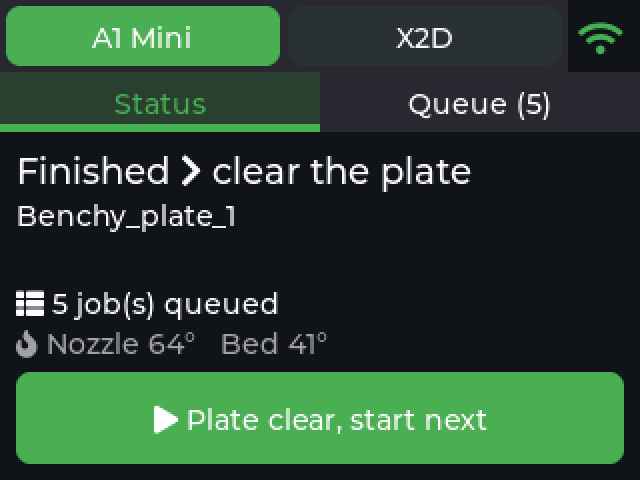
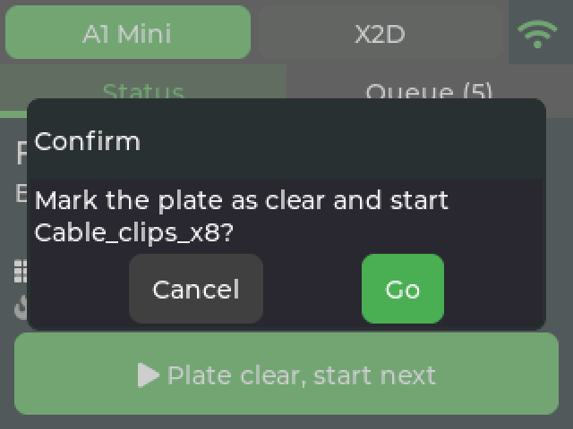
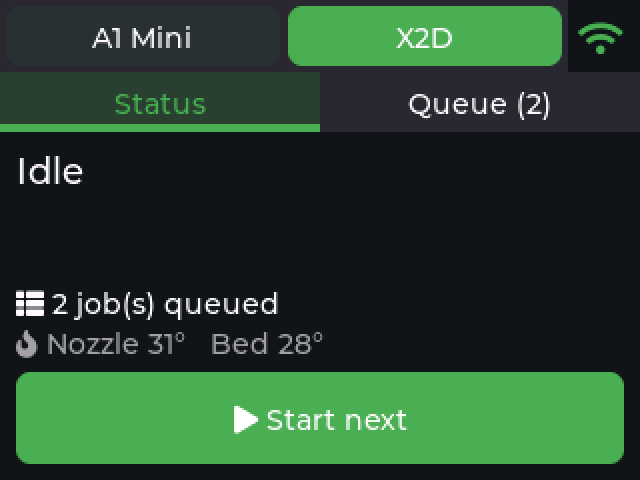

# Bambuddy Touch Display for ESP32-S3 (LCDWIKI ES3C28P)

A small wall/desk controller for [Bambuddy](https://github.com/maziggy/bambuddy), the self-hosted
print archive and queue manager for Bambu Lab printers. It runs on a cheap 2.8" ESP32-S3 touch
panel and lets you see what your printers are doing and **start the next queued print with one
tap**: no phone, no laptop.

| Printing | Queue | Start a job |
|---|---|---|
|  |  |  |
| **Plate needs clearing** | **One tap: plate clear + next job** | **Second printer** |
|  |  |  |

All screenshots (English and Hungarian, every state): [docs/screenshots](docs/screenshots).
They are rendered from the real UI code by `tools/sim/render.sh`, not mock-ups.

## Features

- **Every active printer in Bambuddy** shows up as a tab in the header (up to 4). Add a printer in
  Bambuddy and it appears on the display without touching the firmware.
- **Status tab:** state, job name, progress, time left, layer, nozzle and bed temperatures.
  The buttons change with the state:
  - printing: **Pause / Resume** and **Stop** (Stop asks for confirmation);
  - idle: **Start next**, which starts the first queued job that waits for a manual start;
  - waiting for the plate to be cleared: **Plate clear, start next** acknowledges the empty
    plate and starts the next job in one go.
- **Queue tab:** pending jobs with estimated time and filament. Tap one to start it. If Bambuddy
  reports the spool may run short, the display asks before starting anyway.
- Header icon: green = OK, orange = Bambuddy not answering, red = no Wi-Fi.
- Dims after 2 minutes. The touch that wakes it never presses a button.
- HTTPS with certificate validation, a scoped Bambuddy API key, over-the-air updates.
- English UI by default, Hungarian included. More languages: [src/ui_strings.h](src/ui_strings.h).

## What you need

| Item | Notes |
|---|---|
| **LCDWIKI ES3C28P** 2.8" ESP32-S3 display (touch version) | See [docs/HARDWARE.md](docs/HARDWARE.md) for the exact model and how to recognise it |
| USB-C cable (data, not charge-only) | For the first flash and power |
| Bambuddy reachable over **HTTPS** from the display's network | Tested with Bambuddy 1.2.5.7 |
| 2.4 GHz Wi-Fi | The ESP32-S3 has no 5 GHz radio |

## Setup

### 1. Create a Bambuddy API key

Bambuddy → **Settings → API keys** → new key with these permissions:

- **read status**: status, queue, printer list
- **queue**: start queue items
- **control printer**: pause, resume, stop, plate-clear acknowledgement

Turn everything else off. You can also limit the key to specific printers.
Details: [docs/BAMBUDDY_API.md](docs/BAMBUDDY_API.md).

### 2. Configure

```bash
cp include/secrets.example.h include/secrets.h
```

Fill in Wi-Fi, `BAMBUDDY_HOST`, the API key and an OTA password. Read the `DNS_SERVER_IP`
comment if your Bambuddy host name only resolves to the LAN address on a local DNS (Pi-hole etc.).
For a Hungarian UI, uncomment `#define UI_LANGUAGE_HU`.

### 3. Build

With [PlatformIO](https://platformio.org/) (VS Code extension or CLI):

```bash
pio run -e usb
```

Or with Docker only, no local toolchain:

```bash
docker run --rm -v "$HOME/.cache/pio-docker":/root/.platformio -v "$PWD":/proj -w /proj \
  python:3.12-slim sh -c 'pip install -q platformio==6.1.18 && pio run -e usb'
```

The output is `.pio/build/usb/firmware-merged.bin`, a complete image for flash offset `0x0`.

### 4. Flash (first time, USB)

**From PlatformIO:** `pio run -e usb -t upload`

**From the browser, nothing to install (Chrome or Edge):**

1. Open https://espressif.github.io/esptool-js/
2. Plug in the board, click **Connect**, pick the serial port.
   If no port shows up: hold **BOOT**, tap **RESET**, release **BOOT** (download mode).
3. Flash address `0x0`, file `firmware-merged.bin`, **Program**.
4. Press **RESET**.

`firmware-merged.bin` contains your Wi-Fi password and API key. Do not share it.

### 5. Later updates (Wi-Fi)

```bash
OTA_PASSWORD=<from secrets.h> pio run -e ota -t upload --upload-port <display IP>
```

## UI language

The language is chosen **at compile time**, not on the device: English by default, Hungarian
when `include/secrets.h` contains `#define UI_LANGUAGE_HU`. Change it and flash again.
All text is in [src/ui_strings.h](src/ui_strings.h); add a block there for another language.

## Screenshots without hardware

`tools/sim/render.sh` compiles `src/ui.cpp` and LVGL for your computer, feeds it mock Bambuddy
data, taps through every state and writes PNGs to `docs/screenshots/`. Handy for checking UI
changes before flashing. Needs gcc/g++ and Python with Pillow, plus one `pio run` first (for
the LVGL sources).

## Troubleshooting

| Symptom | Fix |
|---|---|
| Picture upside down | add `-DDISPLAY_ROTATION=3` to `build_flags` |
| Touches land in the wrong place / mirrored | add `-DTOUCH_OFFSET_ROTATION=n` (try 0-7) |
| Colours look negative | `src/board.h`: `c.invert = false` |
| Wi-Fi icon stays red | wrong credentials, or a 5 GHz-only network |
| Icon orange, "Bambuddy unreachable" | DNS resolves to an address the display cannot reach (see `DNS_SERVER_IP`), or a TLS problem: certificate not from Let's Encrypt (replace `src/certs.h`) |
| "Invalid API key or missing permission" | key disabled/expired, or a permission is missing |
| Start does nothing | Normal while the printer is busy: the job starts after the current one. Bambuddy's scheduler sends it when the printer is idle and the plate is acknowledged |
| Accented text shows boxes | that character is not in the fonts; run `tools/gen_fonts.sh` with a wider range |

Serial log: `pio device monitor` (115200 baud, native USB).

## Project layout

```
platformio.ini         build config (board overrides for N16R8, libraries)
merge_bin.py           post-build: single flashable image
include/
  secrets.example.h    configuration template -> copy to secrets.h (git-ignored)
  lv_conf.h            LVGL 9 settings
src/
  main.cpp             display/touch/LVGL setup, OTA, dimming (core 1)
  board.h              pinout + LovyanGFX driver config for the ES3C28P
  net.cpp / net.h      Wi-Fi + Bambuddy API client in a FreeRTOS task (core 0)
  ui.cpp / ui.h        LVGL screens and actions
  model.h              shared state and command structs
  ui_strings.h         all UI text (EN + HU)
  certs.h              Let's Encrypt root certificates
  fonts/               generated LVGL fonts (Latin-1 + Hungarian + symbols)
tools/gen_fonts.sh     regenerates the fonts
tools/sim/             host simulator: renders UI screenshots without hardware
docs/screenshots/      rendered screenshots (EN + HU)
docs/HARDWARE.md       the board: exact model, pinout, settings, pitfalls
docs/BAMBUDDY_API.md   which Bambuddy endpoints are used and how they behave
CLAUDE.md              instructions for Claude (or other AI assistants) working on this code
LICENSE                AGPL-3.0
THIRD_PARTY_NOTICES.md licenses of the bundled fonts and libraries
licenses/              full texts of third-party licenses (OFL-1.1)
```

## Status

The firmware builds cleanly for this board. Pinout, panel and touch settings come from the
vendor's documentation and init code. Rotation, touch mapping and colour inversion are the
settings most likely to need one of the adjustments above on your unit.

## License

[AGPL-3.0-or-later](LICENSE), like [Bambuddy](https://github.com/maziggy/bambuddy) itself.
You may use, modify and share this firmware; if you distribute a modified version (source or
compiled), you must make its source available under the same license.
Third-party components and their licenses: [THIRD_PARTY_NOTICES.md](THIRD_PARTY_NOTICES.md).

## Credits

[Bambuddy](https://github.com/maziggy/bambuddy) · [LVGL](https://lvgl.io) ·
[LovyanGFX](https://github.com/lovyan03/LovyanGFX) · [ArduinoJson](https://arduinojson.org) ·
board documentation by [LCDWIKI](https://www.lcdwiki.com/2.8inch_ESP32-S3_Display).
